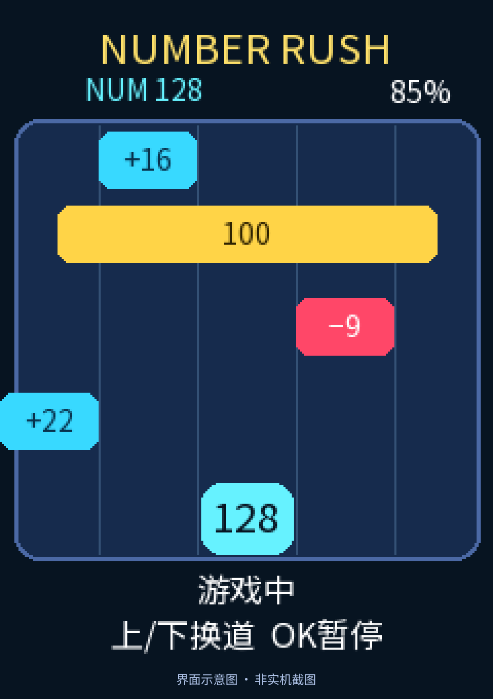
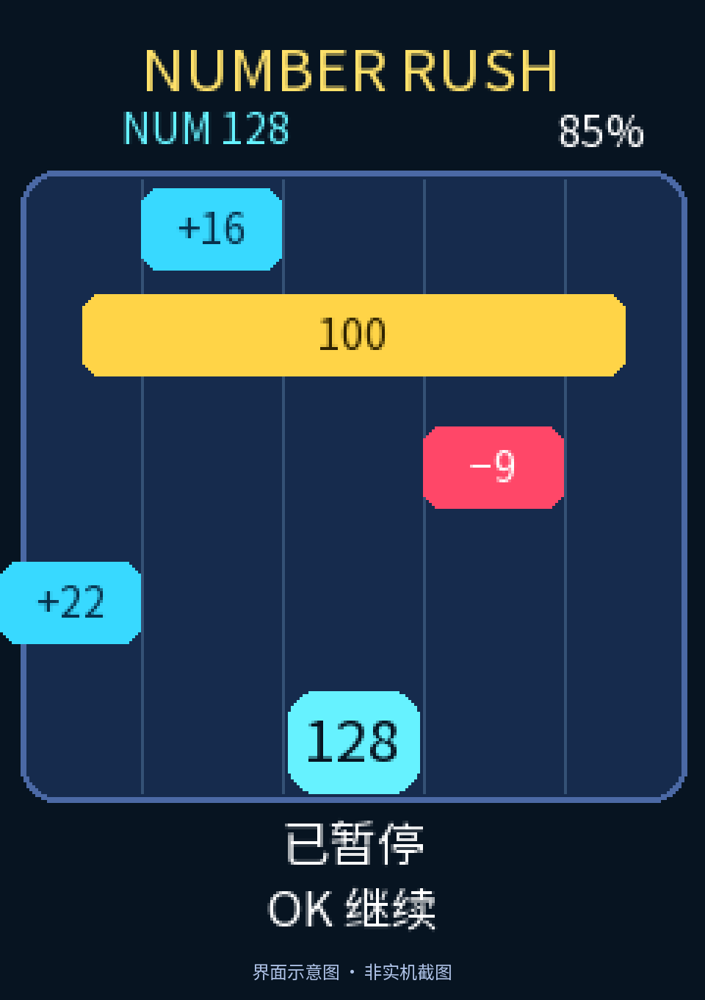

# Number Rush · 数字冲冲冲

运行在 FoloToy AI Passport（ESP32-C3、8MB Flash、240×320 屏幕）上的离线数字跑道游戏。


开机显示封面，按实体 **OK** 键开始。游戏中按 OK 暂停或继续；上键向左换道，下键向右换道；结束后按 OK 重开。AI Passport 使用实体按键，屏幕上的开始按钮是操作入口提示，不要求触摸屏。

## 界面预览

以下图片为按界面布局绘制的示意图，不是实机截图或实机照片。发布时请保留这一说明。

 

## 本版规则

- 初始数字为 2，蓝色数字增加分数，红色数字减少分数，最低为 1。
- 每 5 个数字后出现一个挡板。当前数字必须 **大于** 挡板才能通过。
- 挡板从 10 递增至 100000；本设备版尚未同步网页版本后来新增的挡板和调节控件。
- 支持中文状态、暂停与继续；断电后不保留本局进度。
- 普通每组有一个红色数字，完全由固定数字组成的开场组除外。
- 早期设备版本的 2222、6666 在高门槛阶段会被范围规则替换，本发布版本未改变该玩法逻辑。

## 快速刷入

只适用于上述硬件。刷入会替换当前应用，自定义游戏不支持官方微信小程序功能。请自行妥善保管自己设备的官方恢复文件；不要将身份分区、密钥或二维码内容上传到公共仓库。

安装 Python 3.11 后，在本目录运行：

```powershell
python -m pip install -r requirements-flash.txt
python tools/flash.py --check-only
python tools/flash.py --port COM5
```

COM5 只是示例，请改成实际 USB 串口。脚本先校验固件文件，再读取芯片信息；确认是自己的 ESP32-C3 设备后输入 YES。不会执行整片擦除，也不会写入身份分区。

## 从源码编译

安装 ESP-IDF **5.5.3**，打开 ESP-IDF 终端并进入本目录：

```powershell
idf.py set-target esp32c3
idf.py build
```

依赖版本由 `dependencies.lock` 锁定，组件管理器会下载依赖，需要联网。生成字体和封面 C 文件已经包含在 main/，普通编译无需运行图片工具。预编译固件位于 firmware/。

## 重新生成素材

需先运行一次构建来取得 LVGL 依赖，再安装 Pillow：

```powershell
python -m pip install Pillow
python tools/create_release_art.py . media
python tools/build_passport_font.py .
idf.py build
```

字体来源为 LVGL 所附 Noto Sans SC，许可见 licenses/OFL-NotoSansSC.txt。封面和界面示意图采用可复现绘制脚本生成，不使用 AI 生图服务。

## 文件结构

- main/：游戏、中文字体、设备 RGB565 封面资源。
- components/bsp/：上游 AI Passport 硬件支持代码。
- media/：封面、游戏中和暂停界面示意图。
- firmware/：已编译固件、刷写地址及 SHA-256。
- tools/：刷机工具、图片和字体生成工具。
- docs/PUBLISH.md：GitHub 发布步骤。

## 许可与验证

源码基于 FoloToy AI Passport 的 MIT 许可工程，保留原版权声明；详见 LICENSE 与 THIRD_PARTY_NOTICES.md。本项目非 FoloToy 官方固件。

已完成 ESP-IDF 编译和字体覆盖/行高检查。展示图为示意渲染；真实设备屏幕、按键和开机封面仍应在发布前人工验收。
